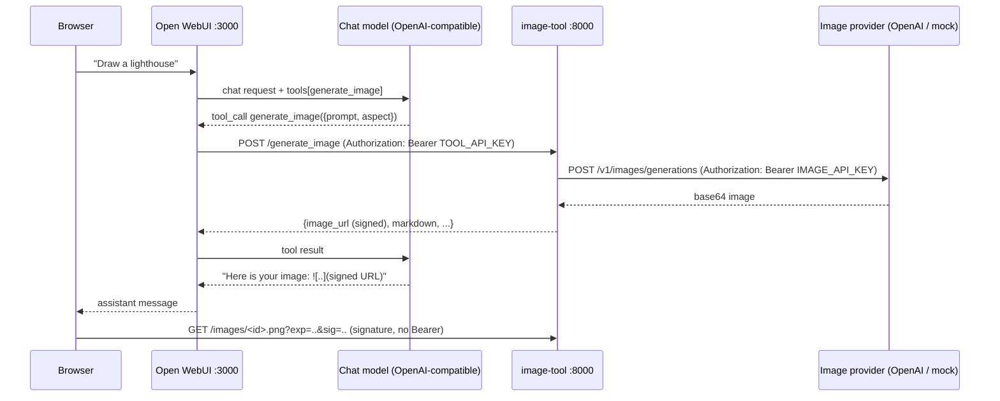

# Open WebUI + Image-Generation Tool Server

A working [Open WebUI](https://github.com/open-webui/open-webui) instance in Docker with
one connected tool: **`generate_image`**, an OpenAPI tool server that lets any
tool-calling model draw pictures on request (OpenAI Images API, or an offline mock
provider so everything also runs without an image-API key).

```
You: "Draw a watercolor lighthouse at dawn"
 └─ Open WebUI ─▶ LLM decides to call generate_image
                   └─ Open WebUI ──(Bearer API key)──▶ image-tool ──(provider key)──▶ OpenAI Images API
                   ◀── {"image_url": "...signed...", "markdown": ""} ──┘
                 LLM replies with the markdown ─▶ the image renders in the chat
```

* **Stack:** Open WebUI `v0.12.0` (pinned) + a small FastAPI service (`image-tool/`).
* **Integration style:** OpenAPI tool server — Open WebUI imports `/openapi.json`, and
  every operation with an `operationId` becomes an LLM tool.
* **Authorization:** Bearer API key (Open WebUI → tool server), provider API key
  (tool server → image API), HMAC-signed expiring URLs (browser → images).
* **Verified:** 75 unit tests, a `curl` smoke test, and a full Open WebUI end-to-end test
  that drives a real chat through the real Open WebUI container (`make e2e`).

---

## Quick start

Requirements: Docker with Compose v2 and `openssl`. `make` is optional (every target is a
thin wrapper); `make smoke` also needs `curl` + `jq`, and `make e2e` needs `python3`.
For the *chat* model you need an OpenAI-compatible endpoint with tool calling (an OpenAI
key is the easiest). The first build/start needs internet access to Docker Hub, `ghcr.io`,
PyPI and `huggingface.co` (Open WebUI fetches a small embedding model once).

```bash
./scripts/init-env.sh                  # generates every secret into .env (mode 600). Optional:
                                       # type an OpenAI key at the hidden prompt (or export
                                       # OPENAI_API_KEY first). It is stored as OPENAI_API_KEY
                                       # (chat) AND IMAGE_API_KEY (real, billed images); press
                                       # Enter to stay on the free offline mock image provider.
docker compose up -d --build --wait    # or: make up
```

The first start pulls the Open WebUI image (~6 GB) and Open WebUI downloads a small
embedding model (watch with `docker compose logs -f open-webui`), so allow a few
minutes; later starts take under a minute. Port 3000 is often taken on dev machines — if
Docker reports `address already in use`, set `WEBUI_PORT` (and/or `TOOL_PORT`) in `.env`
and run `docker compose up -d` again.

Open **http://localhost:3000** (or `http://localhost:<WEBUI_PORT>`) and sign in with the
admin account printed by `init-env.sh` (`admin@example.com` + a generated password, also
stored in `.env`). Public sign-up is disabled; the admin is created on the first start of
an empty data volume (run `make reset` first if you already have an
`owui-image-tool_open-webui-data` volume).

**Use the tool** — global tool servers are opt-in per chat:

1. In the message box open the **Integrations** menu (next to the **＋** button) → **Tools**.
2. Switch on **Image Generator**. (Menu labels can differ slightly between versions.)
3. Ask: *"Draw a watercolor lighthouse at dawn, landscape orientation."*

The model calls `generate_image` and the picture appears inline in the reply.

> **No keys?** With an empty `IMAGE_API_KEY` the tool server uses the offline **mock**
> provider (a placeholder PNG that shows your prompt). Open WebUI still needs *some*
> tool-calling chat model: set `OPENAI_API_KEY`, or point `OPENAI_API_BASE_URL` at any
> OpenAI-compatible server (OpenRouter, Ollama via `http://host.docker.internal:11434/v1` —
> see the `extra_hosts` note in `docker-compose.yml`). With no chat endpoint the model
> picker stays empty; add one to `.env` and run `docker compose up -d`.

| Command | What it does |
|---|---|
| `make init` | same as `./scripts/init-env.sh` |
| `make up` / `make down` | start / stop the stack (data kept) |
| `make reset` | stop and **delete** volumes (chats, users, generated images) |
| `make logs` / `make ps` | follow logs / list containers |
| `make test` | unit tests, run inside Docker |
| `make smoke` | black-box `curl` checks against the running tool server |
| `make e2e` | isolated full-stack test: Open WebUI → tool call → image (needs no API keys) |

(`make help` lists them; `COMPOSE="docker compose -p other"` overrides the compose command.)

Ports: Open WebUI reaches the tool server at `http://image-tool:8000` *inside* the compose
network; your browser loads images from `PUBLIC_BASE_URL` (default
`http://localhost:$TOOL_PORT`, i.e. 8001) and `make smoke` calls `127.0.0.1:$TOOL_PORT`.
Everything is published on `127.0.0.1` only.

---

## How the tool is connected



### Registration (already done for you)

`docker-compose.yml` registers the tool server declaratively through Open WebUI's
`TOOL_SERVER_CONNECTIONS` environment variable:

```json
[{
  "type": "openapi",
  "url": "http://image-tool:8000",
  "spec_type": "url",
  "path": "openapi.json",
  "auth_type": "bearer",
  "key": "<TOOL_API_KEY>",
  "config": {"enable": true,
             "access_grants": [{"principal_type": "user", "principal_id": "*", "permission": "read"}]},
  "info": {"id": "image-tool", "name": "Image Generator", "description": "..."}
}]
```

* `url` is the compose-network hostname — Open WebUI's **backend** fetches the spec and
  makes every tool call, so `localhost` would be wrong here.
* `access_grants` makes the tool usable by all users (otherwise it is admin-only).
* `info.id` gives the stable tool id `server:image-tool`.
* The environment is the source of truth (`ENABLE_PERSISTENT_CONFIG=False`): edit `.env`,
  run `docker compose up -d`, done — no stale UI state.

### Manual registration (same result, through the UI)

The stock compose file already seeds this server. To practise the manual flow: set
`OWUI_PERSISTENT_CONFIG=True` in `.env`, remove the `TOOL_SERVER_CONNECTIONS` line from
`docker-compose.yml`, `make reset && make up`, then go to
**Admin Panel → Settings → Integrations → Tools → ＋** and enter:

| Field | Value |
|---|---|
| Type | OpenAPI |
| URL | `http://image-tool:8000` |
| OpenAPI spec path | `openapi.json` |
| Auth | Bearer — key = `TOOL_API_KEY` from `.env` |
| ID / Name | `image-tool` / `Image Generator` |
| Access | public (or specific users/groups) |

### The tool contract

`POST /generate_image` · operationId `generate_image` · `Authorization: Bearer <key>`

| Field | Type | Notes |
|---|---|---|
| `prompt` | string, 1–1000 chars | detailed visual description |
| `aspect` | `square` \| `landscape` \| `portrait` | default `square` |

Response (JSON): `image_url` (signed, expiring), `markdown` (ready-to-embed
``), `note` (tells the model to paste the markdown verbatim), `prompt`,
`revised_prompt`, `model`, `provider`, `expires_at`.

Errors: tool-level failures return a plain `detail` string the model can act on — `401`
bad key, `413` oversized body, `422` whitespace-only or provider-rejected prompt, `429`
rate limited (after bounded retries), `502`/`504` provider failure or deadline. Schema
violations (empty/over-long/missing `prompt`, unknown `aspect`) return FastAPI's standard
422 validation list instead.

---

## Authorization and secrets

Four independent layers, each with its own credential:

| Hop | Mechanism | Credential | Lives in |
|---|---|---|---|
| Admin → Open WebUI | account created at first start; public sign-up disabled | `WEBUI_ADMIN_PASSWORD` | `.env` |
| Open WebUI → tool server | `Authorization: Bearer` API key, constant-time compare, previous key accepted during rotation | `TOOL_API_KEY` | `.env` → both containers |
| Tool server → image API | `Authorization: Bearer` provider key, sent only upstream, https required | `IMAGE_API_KEY` | `.env` → tool server only |
| Browser → image file | HMAC-SHA256 over *(filename, expiry)*; `` cannot send headers | `URL_SIGNING_KEY` | `.env` → tool server only |

How secrets are handled:

* **Nothing secret is in git.** `.env` is git-ignored; `.env.example` holds only placeholders;
  `scripts/init-env.sh` generates strong random values (`openssl rand`) and writes `.env`
  with mode `600`, using a same-directory temp file that is cleaned up on exit. The API key
  is read from a hidden prompt, never from argv.
* **Never logged or returned.** Settings redact secrets in `repr`; upstream auth errors are
  replaced by a generic message; request logs hold only the path (no query string, so
  signed links never reach the logs). Unit tests enforce each of these.
* **No cross-vendor key leakage.** At runtime the tool server never inherits the *chat*
  model's `OPENAI_API_KEY` (that endpoint may be another vendor); only `IMAGE_API_KEY` is
  used, and it is refused over plain `http://` unless you explicitly opt in.
  `init-env.sh` copies the key you type into both settings deliberately — change
  `IMAGE_API_KEY` afterwards if the two endpoints belong to different vendors.
* **File-based secrets in the app.** The tool server also accepts `<NAME>_FILE` for each of
  `TOOL_API_KEY`, `TOOL_API_KEY_PREVIOUS`, `IMAGE_API_KEY` and `URL_SIGNING_KEY` (Docker /
  Kubernetes secrets; covered by a unit test). The bundled compose file uses `.env`; to use
  files, add a `secrets:` block and the `*_FILE` variables to the `image-tool` service.
* **Least privilege at runtime.** The tool server runs as a non-root user with a read-only
  root filesystem, all capabilities dropped, `no-new-privileges`, CPU/memory/PID limits and
  a `noexec` tmpfs. Open WebUI also drops all capabilities. Ports bind to `127.0.0.1`.
* **Abuse resistance.** 16 KiB request-body cap (enforced before JSON parsing), a single
  deadline for queueing + provider calls + retries, bounded concurrency, an image quota and
  TTL purge, 128-bit random filenames, magic-byte sniffing (only PNG/JPEG/WebP are stored),
  `nosniff` + sandbox CSP, and the provider can never make the server fetch a URL (no SSRF).
* **Key rotation.** Generate a key with `openssl rand -hex 32` (it is embedded in a JSON
  string, so avoid `"`, `\` and `$`), put it in `TOOL_API_KEY` and the old one in
  `TOOL_API_KEY_PREVIOUS`, run `docker compose up -d`, then clear `TOOL_API_KEY_PREVIOUS`.
  Rotating `URL_SIGNING_KEY` invalidates existing image links.

Limits worth knowing (this is a demo-sized deployment, not a vault):

* Environment variables are visible to anyone who can run `docker inspect`; Open WebUI has
  no `*_FILE` support, so for production inject them from a secret manager. After the first
  start you can blank `WEBUI_ADMIN_PASSWORD` in `.env` and run `docker compose up -d`.
* Generated images live on a local volume, so the tool server is single-replica.
* Every Open WebUI user shares the one service key, so there is no per-user quota.

---

## Configuration reference

All variables live in `.env` (see `.env.example`; `ENABLE_SIGNUP` is optional and not in the template).

| Variable | Default | Purpose |
|---|---|---|
| `OPENAI_API_KEY`, `OPENAI_API_BASE_URL` | – / OpenAI | chat model used by Open WebUI |
| `TOOL_API_KEY` | generated | Bearer key Open WebUI → tool server (≥ 24 chars) |
| `TOOL_API_KEY_PREVIOUS` | – | previous key accepted during rotation |
| `URL_SIGNING_KEY` | generated | HMAC key for image links (derived from `TOOL_API_KEY` if empty) |
| `TOOL_PORT`, `PUBLIC_BASE_URL` | `8001`, `http://localhost:$TOOL_PORT` | where the **browser** loads images from — set it when behind a proxy |
| `IMAGE_PROVIDER` | `auto` | `auto` (OpenAI if `IMAGE_API_KEY` is set, else mock), `openai`, `mock` |
| `IMAGE_API_KEY`, `IMAGE_API_BASE_URL` | – / OpenAI | image API credentials / any OpenAI-compatible `/images/generations` server |
| `IMAGE_API_ALLOW_INSECURE` | `false` | allow a keyed `http://` image server (trusted local network only) |
| `IMAGE_MODEL`, `IMAGE_QUALITY` | `gpt-image-2`, – | model id (they change often) and optional quality |
| `IMAGE_TTL_SECONDS`, `MAX_STORED_IMAGES` | `604800`, `1000` | lifetime of images/links and storage quota |
| `MAX_CONCURRENCY`, `REQUEST_TIMEOUT_SECONDS` | `4`, `180` | parallel generations; deadline for one call (keep < 240) |
| `ENABLE_DOCS` | `false` | serve Swagger UI at `/docs` on the tool server |
| `WEBUI_PORT`, `OPEN_WEBUI_IMAGE` | `3000`, `…:v0.12.0` | Open WebUI port and pinned image |
| `WEBUI_SECRET_KEY`, `WEBUI_ADMIN_EMAIL`, `WEBUI_ADMIN_PASSWORD` | generated | JWT secret and first admin |
| `ENABLE_SIGNUP`, `CORS_ALLOW_ORIGIN` | `False`, localhost origins | sign-up switch; browser origins allowed to call Open WebUI (add your hostname if you use one) |
| `OWUI_PERSISTENT_CONFIG` | `False` | `True` keeps admin-UI changes across restarts |

---

## Tests

```bash
make test    # 75 unit tests in Docker: auth, signed URLs, path traversal, size limits,
             # deadlines, quotas, provider request/error mapping + retries, config & secrets
make smoke   # curl checks against the running tool server (needs `make up`)
make e2e     # isolated stack + mock LLM: proves Open WebUI really calls the tool
```

`make e2e` starts its own compose project (`owui-image-tool-e2e`, ports 13000 / 18001 /
19001; override with `E2E_PROJECT`, `E2E_WEBUI_PORT`, `E2E_TOOL_PORT`, `E2E_MOCK_LLM_PORT`;
run one at a time per project name) with throw-away secrets and
replaces both the chat model *and* the image API with a deterministic mock
(`e2e/mock_llm.py`). It signs in to the real Open WebUI container, runs a chat that
triggers `generate_image`, and asserts that: the tool server refuses calls without the key;
sign-up is closed; Open WebUI imported the tool from `TOOL_SERVER_CONNECTIONS` and offered it
to the model; the call succeeded (only possible with the correct Bearer key); the tool
server authenticated to the image API with its own key; the reply contains the markdown
image; and the image downloads through its signed URL while a tampered link is rejected.
It needs no API keys, takes a few minutes the first time, and cleans up after itself.

---

## Project layout

```
docker-compose.yml        Open WebUI + image-tool, hardened, localhost-only ports
.env.example              all settings, documented (copy via scripts/init-env.sh)
.gitignore                keeps .env / secrets out of git
Makefile                  init / up / down / reset / logs / ps / test / smoke / e2e wrappers
scripts/init-env.sh       generates .env with random secrets
scripts/smoke-test.sh     black-box checks of the tool server
image-tool/
  Dockerfile              `runtime` and `test` build targets
  requirements*.txt       runtime / dev dependencies (pinned)
  .dockerignore           keeps .env / secrets out of the build context
  app/main.py             FastAPI app: /generate_image, /images/{file}, /healthz
  app/config.py           env + *_FILE settings, validation
  app/security.py         Bearer guard (constant time), HMAC signed URLs
  app/limits.py           request-body size cap
  app/storage.py          safe image store, magic-byte sniffing, TTL purge, quota
  app/providers/          ImageProvider interface; openai.py, mock.py
  tests/                  pytest suite
e2e/
  run.sh                  orchestrates the isolated stack and the assertions
  run_e2e.py              the assertions (standard library only)
  mock_llm.py             deterministic OpenAI-compatible chat + images server
  docker-compose.e2e.yml  overlay that swaps the real models for the mock
```

Adding another backend (Stability, a local Stable-Diffusion server, …) means implementing
the `ImageProvider` protocol in `app/providers/base.py` (a `name` and an async `generate`),
adding a branch to `build_provider()` in `app/providers/__init__.py` and the new name to
`PROVIDERS` in `app/config.py`. Any server exposing OpenAI's `/images/generations` works
today via `IMAGE_API_BASE_URL`.

---

## Design decisions

* **OpenAPI tool server instead of MCP.** Open WebUI consumes OpenAPI natively and lets the
  admin attach a Bearer key, so no bridge process is needed. (An MCP server can be exposed
  the same way through `mcpo`.)
* **Signed URLs + markdown instead of inline base64.** Images stay out of the model's
  context window, chat history stays small, and links expire on their own.
* **A mock provider.** It makes the stack, the tests and the e2e run reproducible without
  paid keys, and doubles as a safe default.
* **Env-seeded, declarative Open WebUI config.** The connection (and its key) always
  matches `.env`, so there is no stale UI state to debug.

## Troubleshooting

| Symptom | Check |
|---|---|
| "Image Generator" is missing in **Integrations → Tools** | `docker compose logs open-webui \| grep -i "tool server"` should say `Initialized 1 tool server(s)`; the spec is fetched at startup — `docker compose restart open-webui` |
| Model answers in text and never calls the tool | use a model with native tool calling and make sure the tool toggle is on for this chat |
| Image link shows as broken | `PUBLIC_BASE_URL` must be reachable **from your browser** (not the compose hostname) |
| Images are placeholders ("MOCK IMAGE PROVIDER") | `IMAGE_API_KEY` is empty — set it in `.env` and `docker compose up -d` |
| Tool returns `401` | `TOOL_API_KEY` in `.env` changed — `docker compose up -d` recreates both containers with the new key |
| `provider refused our credentials` | wrong/expired `IMAGE_API_KEY`, or your account lacks access to `IMAGE_MODEL` — try `gpt-image-2` |
| UI loads but live updates/login fail from another hostname | add that origin to `CORS_ALLOW_ORIGIN` |
| `failed to bind host port 127.0.0.1:3000/tcp: address already in use` | set `WEBUI_PORT` / `TOOL_PORT` in `.env`, then `docker compose up -d` again (the failed start leaves the tool server running) |
